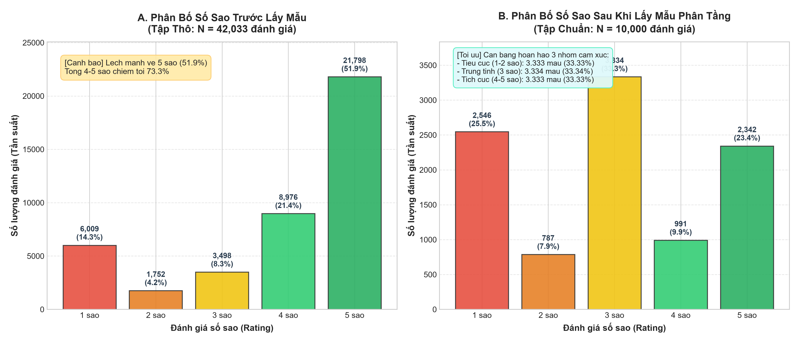
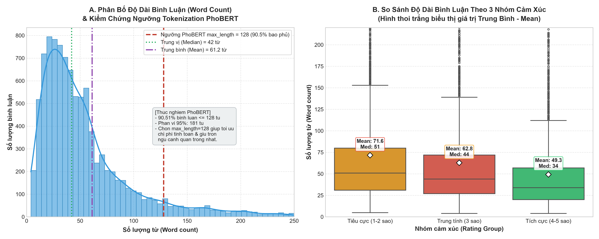
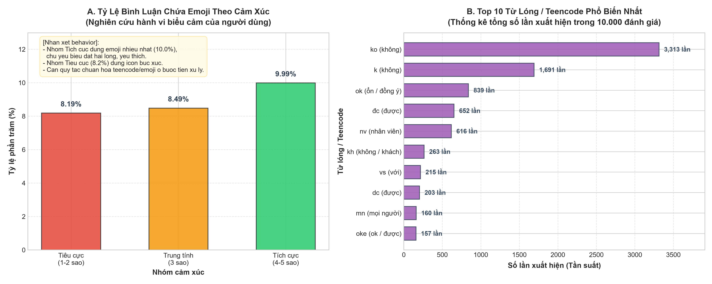
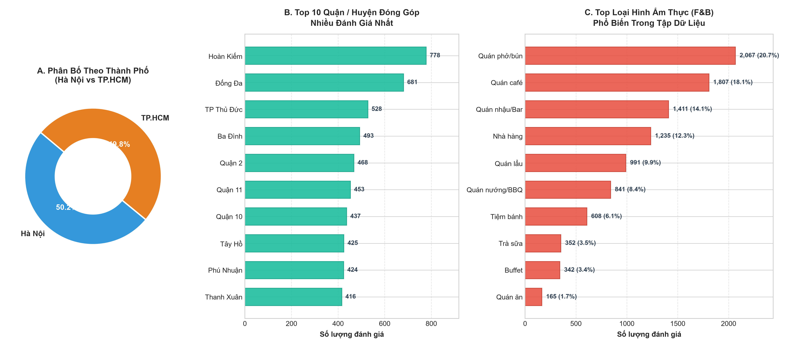

# Giai Đoạn 3: Khám Phá & Tiền Xử Lý Dữ Liệu (EDA & Stratified Sampling)

Thư mục này chứa toàn bộ mã nguồn, dữ liệu chuẩn hóa, hình ảnh trực quan hóa và báo cáo phân tích khám phá dữ liệu (Exploratory Data Analysis - EDA) cho đồ án môn học **Khai thác Dữ liệu Truyền thông Xã hội (IE403)**.

---

## 📌 Mục Tiêu Nghiên Cứu

Giai đoạn này đóng vai trò bản lề trong chu trình khoa học dữ liệu và xử lý ngôn ngữ tự nhiên (NLP), nhằm:
1. **Kiểm định chất lượng dữ liệu thô (Data Profiling)**: Đánh giá tập dữ liệu 42.273 đánh giá ẩm thực cào từ 1.500 quán tại TP.HCM và Hà Nội, nhận diện tỷ lệ khuyết thiếu và hiện tượng mất cân bằng số sao trầm trọng (*Class Imbalance*).
2. **Làm sạch & Chuẩn hóa (Data Cleaning & Normalization)**: Loại bỏ các tạp âm hệ thống (chuỗi dịch tự động của Google), lọc bỏ bình luận ngắn/nhiễu và khử trùng lặp hoàn toàn.
3. **Ẩn danh hóa dữ liệu (Anonymization)**: Đảm bảo đạo đức nghiên cứu bằng cách loại bỏ tên tài khoản người đánh giá, URL Google Maps và mã hóa định danh quán thành `place_id`.
4. **Lấy mẫu phân tầng cân bằng (Stratified Sampling - 10.000 mẫu)**: Cân bằng hoàn hảo 3 nhóm cảm xúc (*Tiêu cực, Trung tính, Tích cực*) làm đầu vào tối ưu cho mô hình ngôn ngữ lớn (LLM Labeling).
5. **Xây dựng tập đối chứng chuẩn (Gold Standard - 200 mẫu)**: Trích xuất phân tầng 200 mẫu ẩn số sao để 4 thành viên gán nhãn độc lập phục vụ kiểm định độ tin cậy liên người gán (*Fleiss' Kappa*) và đối chứng với LLM (*Cohen's Kappa*).
6. **Khảo sát đặc trưng ngôn ngữ mạng**: Phân tích độ dài câu (kiểm chứng ngưỡng `max_length=128` cho PhoBERT), thống kê tần suất từ lóng (*Teencode*) và biểu tượng cảm xúc (*Emoji*).

---

## 📁 Cấu Trúc Thư Mục `3.EDA/`

```text
3.EDA/
│
├── filter_sample_10k.py            # Script tiền xử lý, khử trùng lặp, ẩn danh và lấy mẫu phân tầng 10k
├── generate_figures.py             # Script vẽ và xuất 4 biểu đồ EDA độ phân giải cao (DPI=300)
├── execute_notebook_inprocess.py   # Script thực thi tự động các cell và xuất outputs cho Notebook
├── eda_raw_and_sampled.ipynb       # Jupyter Notebook hoàn chỉnh có sẵn outputs và phân tích học thuật
│
├── dataset_10000_unlabeled.csv     # Bộ dữ liệu 10.000 đánh giá cân bằng sẵn sàng cho LLM gán nhãn
├── gold_standard_200_template.csv  # Mẫu đối chứng 200 đánh giá (ẨN số sao) cho 4 thành viên nhóm
│
├── figures/                        # Thư mục lưu trữ biểu đồ trực quan hóa độ phân giải cao
│   ├── star_distribution_comparison.png  # So sánh phân bố số sao trước và sau lấy mẫu
│   ├── word_count_analysis.png           # Phân bố độ dài từ & Boxplot theo nhóm cảm xúc
│   ├── teencode_and_emoji_stats.png      # Tỷ lệ sử dụng Emoji & Top 10 Teencode
│   └── location_and_category_dist.png    # Phân bố địa lý và danh mục ngành hàng F&B
│
└── README.md                       # Tài liệu báo cáo chi tiết Giai đoạn 3 (file này)
```

---

## 📊 1. Quy Trình Làm Sạch & Lấy Mẫu Phân Tầng

### 1.1. Phễu Lọc Dữ Liệu (Data Filtering Funnel)

| Bước thực hiện | Tiêu chí xử lý | Số lượng còn lại | Số lượng bị loại |
| :--- | :--- | :---: | :---: |
| **0. Dữ liệu thô ban đầu** | Đọc từ `2.Crawl_data/fnb_reviews_30_per_place.csv` | **42.273** | - |
| **1. Khử khuyết thiếu (NaN)** | Loại bỏ bản ghi khuyết thiếu ở `so_sao` hoặc `noi_dung_review` | **42.008** | -265 dòng |
| **2. Làm sạch & Lọc độ dài** | Xóa tag Google Translate, yêu cầu $\ge 4$ từ và có ký tự Latin/Việt | **41.930** | -78 dòng |
| **3. Khử trùng lặp nội dung** | Áp dụng `drop_duplicates(subset=['noi_dung_review'])` | **41.652** | -278 dòng |
| **4. Lấy mẫu phân tầng cân bằng** | Lấy ngẫu nhiên theo 3 nhóm cảm xúc với seed cố định `random_state=42` | **10.000** | Tập chuẩn |

### 1.2. Giải Quyết Mất Cân Bằng Nhãn (Class Imbalance)

Trong dữ liệu cào thô từ Google Maps, người dùng có xu hướng đánh giá cực kỳ thiên lệch về 5 sao (chiếm **51.89%**), tổng nhóm tích cực (4-5 sao) chiếm tới **73.26%**, trong khi nhóm trung tính 3 sao chỉ chiếm vỏn vẹn **8.33%**.

Chiến lược lấy mẫu phân tầng 10.000 mẫu đã tái cấu trúc hoàn hảo tỷ lệ phân bổ:

| Nhóm cảm xúc | Số sao | Số lượng thô (sau lọc) | Tỷ lệ thô (%) | Số lượng sau lấy mẫu (10k) | Tỷ lệ sau lấy mẫu (%) |
| :--- | :---: | :---: | :---: | :---: | :---: |
| **Tiêu cực (Negative)** | 1.0 & 2.0 sao | 7.737 | 18.58% | **3.333** | **33.33%** |
| *(Trong đó: 1 sao)* | 1.0 sao | 5.989 | 14.38% | 2.546 | 25.46% |
| *(Trong đó: 2 sao)* | 2.0 sao | 1.748 | 4.20% | 787 | 7.87% |
| **Trung tính (Neutral)** | 3.0 sao | 3.489 | 8.38% | **3.334** | **33.34%** |
| **Tích cực (Positive)** | 4.0 & 5.0 sao | 30.426 | 73.05% | **3.333** | **33.33%** |
| *(Trong đó: 4 sao)* | 4.0 sao | 8.932 | 21.44% | 991 | 9.91% |
| *(Trong đó: 5 sao)* | 5.0 sao | 21.494 | 51.60% | 2.342 | 23.42% |
| **Tổng cộng** | - | **41.652** | **100%** | **10.000** | **100%** |



> **💡 Ý nghĩa thực tiễn**: Việc cân bằng hoàn hảo tỷ lệ 3 cực (**33.33% : 33.34% : 33.33%**) ngăn chặn mô hình học máy và LLM bị thiên kiến dự đoán nghiêng về nhãn đa số (Majority Class Bias), giúp mô hình nhạy bén hơn với các sắc thái trung tính và tiêu cực.

---

## 📈 2. Phân Tích Độ Dài Văn Bản & Luận Cứ Chọn Ngưỡng PhoBERT

### 2.1. Thống Kê Độ Dài Từ (Word Count)

- **Số từ trung bình (Mean)**: 61.23 từ
- **Trung vị (Median)**: 42.00 từ
- **Độ lệch chuẩn (Std)**: 63.85 từ
- **Phân vị 90% (P90)**: 133.00 từ
- **Phân vị 95% (P95)**: 181.05 từ
- **Phân vị 99% (P99)**: 327.01 từ
- **Tỷ lệ bình luận $\le 128$ từ**: **90.51%**



### 2.2. Luận Chứng Khoa Học Cho Ngưỡng `max_length = 128`
Trong mô hình Transformer học sâu tiếng Việt (như PhoBERT `vinai/phobert-base-v2`), cơ chế *Self-Attention* có độ phức tạp tính toán và tiêu thụ bộ nhớ tỉ lệ $O(L^2)$ với chiều dài chuỗi $L$:
- Ngưỡng **128 từ** bao phủ trọn vẹn **90.51%** các đánh giá mà không cần cắt cụt văn bản (*truncation*).
- So với ngưỡng `max_length = 256`, việc lựa chọn 128 giúp **giảm 4 lần chi phí ma trận Attention**, cho phép tăng gấp đôi kích thước lô (*batch size*) khi fine-tuning trên GPU, rút ngắn thời gian huấn luyện mà không làm suy giảm hiệu năng trích xuất khía cạnh.

### 2.3. Tương Phản Độ Dài Giữa Các Nhóm Cảm Xúc (Boxplot Insights)

| Nhóm cảm xúc | Số lượng mẫu | Độ dài trung bình (Mean) | Trung vị (Median) | Độ lệch chuẩn (Std) |
| :--- | :---: | :---: | :---: | :---: |
| **Tiêu cực (1-2 sao)** | 3.333 | **71.59 từ** | **51.0 từ** | 72.32 |
| **Trung tính (3 sao)** | 3.334 | **62.80 từ** | **44.0 từ** | 64.63 |
| **Tích cực (4-5 sao)** | 3.333 | **49.30 từ** | **34.0 từ** | 52.48 |

> **🔍 Nhận xét tâm lý hành vi**: Người tiêu dùng khi có trải nghiệm tiêu cực có xu hướng viết rất dài để bộc lộ bức xúc và giải thích cặn kẽ nguyên nhân (thái độ phục vụ, giá cả, vệ sinh). Ngược lại, người tiêu dùng hài lòng thường để lại những lời khen ngắn gọn, súc tích.

---

## 💬 3. Đặc Trưng Ngôn Ngữ Mạng: Teencode & Emoji



### 3.1. Thói Quen Sử Dụng Biểu Tượng Cảm Xúc (Emoji)
- **Tỷ lệ trung bình toàn bộ tập dữ liệu**: **8.89%** bình luận có chứa ít nhất 1 biểu tượng cảm xúc.
- **Theo nhóm cảm xúc**:
  - Nhóm Tích cực (4-5 sao): **9.99%** (Đặc biệt mức 5 sao đạt **11.14%** - thường dùng các icon khen ngợi: ❤️, 👍, 😍).
  - Nhóm Trung tính (3 sao): **8.49%**.
  - Nhóm Tiêu cực (1-2 sao): **8.19%** (Mức 1 sao đạt **7.86%** - thường dùng các icon bày tỏ phẫn nộ, thất vọng: 😡, 👎, 🤮).

### 3.2. Top 10 Từ Lóng / Teencode Phổ Biến Nhất

| Hạng | Từ lóng / Teencode | Từ gốc chuẩn hóa | Tổng số lần xuất hiện | Số bình luận chứa từ |
| :---: | :--- | :--- | :---: | :---: |
| **1** | `ko` | không | 3.313 lần | 1.656 review |
| **2** | `k` | không | 1.691 lần | 949 review |
| **3** | `ok` | ổn / đồng ý | 839 lần | 728 review |
| **4** | `đc` | được | 652 lần | 505 review |
| **5** | `nv` | nhân viên | 616 lần | 428 review |
| **6** | `kh` | không / khách hàng | 263 lần | 141 review |
| **7** | `vs` | với | 215 lần | 184 review |
| **8** | `dc` | được | 203 lần | 165 review |
| **9** | `mn` | mọi người | 160 lần | 145 review |
| **10** | `oke` | ok / được | 157 lần | 139 review |

> **🛠️ Ứng dụng cho Giai đoạn Gán nhãn & Tiền xử lý**: Kết quả này khẳng định sự cần thiết của việc xây dựng từ điển chuẩn hóa Teencode (`ko`, `k` $\rightarrow$ `không`; `đc`, `dc` $\rightarrow$ `được`; `nv` $\rightarrow$ `nhân viên`) và chuyển đổi Emoji sang dạng text descriptor trước khi đưa vào mô hình Transformer.

---

## 🗺️ 4. Phân Bố Không Gian Địa Lý & Ngành Hàng Ẩm Thực



- **Cân bằng địa lý hoàn hảo**:
  - **Hà Nội**: 5.016 mẫu (**50.16%**)
  - **TP. Hồ Chí Minh**: 4.984 mẫu (**49.84%**)
- **Top 5 quận/huyện đóng góp nhiều đánh giá nhất**:
  1. Hoàn Kiếm (Hà Nội): 778 mẫu
  2. Đống Đa (Hà Nội): 681 mẫu
  3. TP. Thủ Đức (TP.HCM): 528 mẫu
  4. Ba Đình (Hà Nội): 493 mẫu
  5. Quận 2 (TP.HCM): 468 mẫu
- **Đa dạng hóa danh mục ngành hàng F&B**:
  - Quán phở/bún: 2.067 mẫu (20.7%)
  - Quán café: 1.807 mẫu (18.1%)
  - Quán nhậu/Bar: 1.411 mẫu (14.1%)
  - Nhà hàng: 1.235 mẫu (12.4%)
  - Quán lẩu & Quán nướng: 1.832 mẫu (18.3%)
  - Tiệm bánh, Trà sữa, Buffet, Quán ăn bình dân: 1.648 mẫu (16.4%)

---

## 🎯 5. Thiết Kế Tập Đối Chứng Chuẩn (Gold Standard - 200 Mẫu)

File `3.EDA/gold_standard_200_template.csv` được thiết lập nhằm làm thước đo chuẩn (*Ground Truth*) để đánh giá chất lượng gán nhãn của LLM (GPT-4o / Gemini 1.5):
1. **Quy mô & Phân tầng**: Đúng **200 mẫu** trích xuất phân tầng từ tập 10.000 dòng:
   - 66 mẫu Tiêu cực (1-2 sao)
   - 68 mẫu Trung tính (3 sao)
   - 66 mẫu Tích cực (4-5 sao)
2. **Ẩn số sao (`so_sao`)**: Cột xếp hạng sao bị loại bỏ hoàn toàn để người gán nhãn đánh giá khách quan dựa trên câu chữ.
3. **Cấu trúc trường thông tin gán nhãn**:
   - `id`, `place_id`, `thanh_pho`, `quan_huyen`, `phan_loai`, `thoi_gian`, `so_luot_thich`, `noi_dung_review`
   - `sentiment_1`, `is_mixed_1`: Nhãn phân loại cảm xúc và cờ cảm xúc hỗn hợp của Thành viên 1.
   - `sentiment_2`, `is_mixed_2`: Của Thành viên 2.
   - `sentiment_3`, `is_mixed_3`: Của Thành viên 3.
   - `sentiment_4`, `is_mixed_4`: Của Thành viên 4.
4. **Mục đích kiểm định**:
   - Đo lường hệ số tương đồng liên người gán **Fleiss' Kappa** giữa 4 thành viên nhóm.
   - Đo lường hệ số **Cohen's Kappa** giữa nhãn đồng thuận của con người (*Human Consensus*) và nhãn sinh bởi mô hình ngôn ngữ lớn (LLM).

---

## 🚀 6. Hướng Dẫn Tái Lập Kết Quả (Reproducibility)

Để chạy lại toàn bộ quy trình từ dòng lệnh:

```bash
# 1. Chạy tiền xử lý và lấy mẫu phân tầng 10k (tự động xuất 2 file CSV)
python -X utf8 3.EDA/filter_sample_10k.py

# 2. Vẽ và xuất 4 biểu đồ độ phân giải cao vào 3.EDA/figures/
python -X utf8 3.EDA/generate_figures.py

# 3. Thực thi và cập nhật kết quả vào Jupyter Notebook
python -X utf8 3.EDA/execute_notebook_inprocess.py
```

Sau đó, có thể mở trực tiếp file `3.EDA/eda_raw_and_sampled.ipynb` trên VS Code hoặc JupyterLab để quan sát toàn bộ bảng biểu và đồ họa đã được render sẵn.
